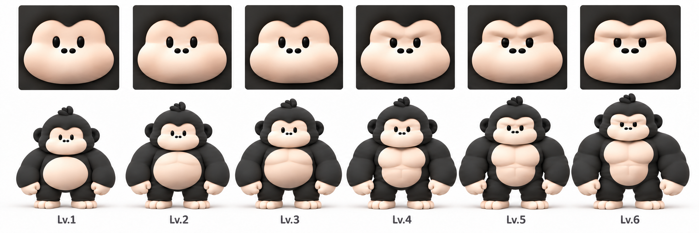

# 릴라 레벨별 최종 디자인 v1

2026-10-12 사용자가 최종 승인한 아이콘·전신 통합 시트입니다.

## 확정 기준

- 위쪽은 레벨별 얼굴 아이콘, 아래쪽은 해당 레벨 전신입니다.
- 털 기준색은 중성 차콜 `#2A2A2A`입니다. 렌더링의 조명·음영 픽셀은 기준색과 다릅니다.
- 아이보리 피부, 작은 눈과 코, 입 없는 얼굴, 검은 귀와 짧은 머리털을 유지합니다.
- 1레벨은 둥글고 부드러운 체형입니다.
- 2레벨은 아주 옅은 가슴 윤곽, 3레벨은 조금 더 드러나는 가슴·팔 근육선으로 구분합니다.
- 2·3레벨의 둥근 배와 부드러운 체형을 유지합니다.
- 4~6레벨은 두꺼운 허리와 발달한 상체를 가진 파워리프터 체형으로 성장합니다.
- 왕관·망토 및 레벨에 따른 털색 변화는 사용하지 않습니다.
- 추가 생성으로 이 승인 원본을 덮어쓰지 않습니다. 수정본은 새 버전으로 관리합니다.

## 적용 범위

이 변경은 최종 디자인 원본과 기준의 확정입니다. 이 시트는 비교용 합본으로,
개별 투명 전신 에셋이나 1024px 정사각형 앱 아이콘의 배포용 원본은 아닙니다.
기존 앱 아이콘과 런타임 동작은 이 커밋에서 변경하지 않습니다.
레벨별 개별 에셋 추출·크롭 검수와 앱 연결은 별도 구현 단계입니다.
레벨별 자동 아이콘 변경 정책은 아직 확정하지 않았습니다.
